# Overview header: four directions

A design note for the top of the Overview, above the history chart ([UI.md](../UI.md#overview), "The answer", "Hero number", "Can I retire yet?"). It proposes four directions to choose from. Nothing here is built yet. The chosen direction is built in a follow-up, which also updates UI.md's "Overview" section.

The history chart and everything below it stay as they are in every direction. The answer's card below the chart, shown before there's an answer, stays too. All values are made up, from UI.md's wireframes.

A, B and C also have high-fidelity mocks, under their wireframes ([A](#mocks), [B](#mocks-1), [C](#mocks-2)). They're SVGs in [overview-header/](overview-header/), drawn by hand with the app's colors (`Assets.xcassets`), its spacing (`Metrics`) and the system text styles at the default size. They aren't screenshots: on a Mac they render in SF Pro, elsewhere in a fallback font, so line lengths are approximate.

## Today

When the main plan has an answer, the header stacks the answer, its details and net worth. Here it is with every piece showing, with results out of date:

```
┌──────────────────────────────────────────┐
│ Overview                        👁   ⚙︎   │
│                                          │
│ Can I retire yet?                      › │  ← subheadline
│ Not yet · earliest                       │  ← largeTitle: may wrap on an iPhone
│ at 54                                    │
│ About 15 years to go · March 2042        │  ← body
│ The first age that works in 9 of 10      │  ← footnote
│ simulated futures                        │
│ ▇▇▇▇▇▇▇▇▇▇▇▇▇▇▇▇▇▇▇▇▇▇▇░░░░░░░░░░░░░░░░░ │
│ 58% of what you'd need to retire today ⓘ │  ← footnote
│ On plan · 12.400 € ahead of your Jan     │  ← subheadline
│ baseline                                 │
│ Calculated before your latest changes    │  ← caption
│ [Calculate]                              │
│ Estimates, not financial or tax advice.  │  ← caption
│                                          │
│ Net worth                                │  ← subheadline
│ 312.480 €                                │  ← title
│ ▲ 4.210 € in September    ▲ 6,2% this yr │  ← subheadline
│                                          │
│ 3Y ▾                            Future ◯ │  ← the chart starts here
└──────────────────────────────────────────┘
```

What makes it heavy:

- **Too many sentences.** The answer is followed by five more lines of prose (the time to go, the confidence, the readiness, the baseline, the run status) before the disclaimer. Each one is useful, but they all have about the same weight.
- **Six text styles** (largeTitle, title, body, subheadline, footnote, caption), with little difference between the smaller ones.
- **Two heroes.** Net worth, in title, competes with the answer for the eye.
- **Readiness and the baseline** are two separate sentences, although both say how far along you are.
- **The run status and the disclaimer** come between the answer and net worth, in the same column as the rest.

On an iPhone at a larger text size, the chart starts about two-thirds of the way down the first screen.

### Inventory

These are the pieces each direction keeps, moves or drops:

| # | Piece | Today |
| --- | --- | --- |
| 1 | "Can I retire yet?" and the chevron | label row |
| 2 | The answer: "Not yet · earliest at 54", "Yes", "Not yet" | largeTitle |
| 3 | Time to go: "About 15 years to go · March 2042" | body |
| 4 | Confidence: "The first age that works in 9 of 10 simulated futures" | footnote |
| 5 | Readiness: the bar, "58% of what you'd need to retire today" and its ⓘ | footnote |
| 6 | Baseline standing: "On plan · 12.400 € ahead of your Jan baseline" | subheadline |
| 7 | Run status: recorded at a check-in, calculating, out of date with *Calculate*, can't be calculated | caption |
| 8 | Disclaimer: "Estimates, not financial or tax advice." | caption |
| 9 | Net worth, its amount and its two changes (and the partial-total note) | title |
| 10 | Coast point: "You're past the coast point: saving nothing more, you could still retire at 63." | not on the Overview yet |

The coast point line (10) is new to the Overview. In today's layout it would be one more sentence, two lines on an iPhone, after the baseline.

## Choices every direction shares

**Coast point line (10).** It shows only while you're past the coast point: while the coast age, from the latest results or recorded at the check-in, is at or under the age the first pension starts ([PROGRESS.md](../PROGRESS.md#milestones)). The directions differ only in where it goes. In every direction that shows it:

- Before you're past the coast point, there's no line. Progress's Milestones card says where it stands ("The coast point is 67, when your first pension starts.").
- Without a pension there's no coast point, and so no line. There's none either for an answer recorded at a check-in before check-ins recorded the coast age.
- With "Yes" there's no line: the answer already says you could stop today. When no age works out, there's no coast age either.
- It has no amounts, so hiding amounts doesn't change it. It dims with the answer when results are out of date.
- Where a direction shortens it ("Past the coast point: 63 without saving"), VoiceOver reads the whole sentence.

Two more pieces can go in more than one place, independent of the layout. Each direction below picks one option, but any option works with any direction.

**Run status (7).** It's needed only when the answer isn't current.

- **R1, in the label row.** The status sits at the right of "Can I retire yet?", before the chevron: "◷ 30 Sep" for an answer recorded at a check-in (VoiceOver reads "As recorded at the check-in on 30 Sep 2026"), a small *Calculate* button when results are out of date, "Calculating 29%" while it runs. Out-of-date lines dim slightly, as the Plan screen dims out-of-date results. It adds no line.
- **R2, a row in the answer's card.** The same words and button, as the card's last row, only when there's a status. It adds a line only when it's needed.

In both, "Base case can't be calculated: …" with *Try Again* and *Open Plan* keeps a line of its own under the answer, as today. It's rare and needs action.

**Disclaimer (8).** It's already on the welcome screen and at the end of the Plan screen, under the chapters.

- **D1, in the answer's ⓘ.** One ⓘ explains the whole answer: the readiness (today's text), what "9 of 10 futures" means, and the disclaimer at the end. The Overview keeps it one tap away.
- **D2, one caption under the header.** As today, but the header's only caption, after everything else.
- **D3, on the Plan screen only.** The Overview leaves it out; it stays on the Plan screen and in the welcome.

Whether the disclaimer must stay visible on the Overview (D2) is an open question for the owner, below.

## A. Trimmed

Today's order and hierarchy, with each piece said once and shorter. The answer is the only hero. Everything under it is one of two smaller styles.

```
┌──────────────────────────────────────────┐
│ Overview                        👁   ⚙︎   │
│                                          │
│ Can I retire yet?                    ⓘ › │  ← subheadline, secondary
│ Not yet                                  │  ← largeTitle
│ Earliest at 54 · March 2042              │  ← title3
│ About 15 years · in 9 of 10 futures      │  ← subheadline, secondary
│ ▇▇▇▇▇▇▇▇▇▇▇▇▇▇▇▇▇▇▇▇▇▇▇░░░░░░░░░░░░░░░░░ │
│ 58% of what retiring today needs         │  ← subheadline, secondary
│ On plan · 12.400 € ahead of January      │  ← subheadline
│ Past the coast point: 63 without saving  │  ← subheadline, secondary
│                                          │
│ Net worth 312.480 €                      │  ← title3
│ ▲ 4.210 € in September  ▲ 6,2% this year │  ← subheadline
│                                          │
│ 3Y ▾                            Future ◯ │
└──────────────────────────────────────────┘
```

- **Keeps:** every piece but the disclaimer. The answer splits into "Not yet" (the hero) and "Earliest at 54 · March 2042"; the time to go and the confidence share a line. The baseline is named as Progress names it ("ahead of January"). The coast point line comes last, after the baseline: both say how far along you are.
- **Moves:** the readiness ⓘ to the label row, where it explains the whole answer and holds the disclaimer (D1). The run status to the label row (R1).
- **Drops:** "of your … baseline" and "simulated" from the wording, and the coast point line shortens to "Past the coast point: 63 without saving"; nothing else.
- **Type styles:** three (largeTitle, title3, subheadline), down from six. Net worth's amount is the same size as the earliest age: both are the second tier.

**Why.** It's the smallest change, and nothing a reader relies on goes missing. The header becomes a headline, two numbers and a few quiet lines. It still reads as text, though, just less of it.

### States

| State | What the header shows |
| --- | --- |
| Not yet, with an age | as above |
| Yes | "Yes" / "You could retire today" / "In at least 9 of 10 futures"; the bar is full and reads "130% of what retiring today needs" |
| No age works out | "Not yet" / "No age works in 9 of 10 futures yet"; the bar and the baseline as usual |
| Not past the coast point | no coast point line: the baseline is the last line |
| Recorded at a check-in | the label row reads "Can I retire yet?  ◷ 30 Sep  ⓘ ›"; an answer recorded before readiness existed shows "Calculate the plan to see how close you are to retiring today." in the bar's place |
| Out of date | the label row reads "Can I retire yet?  [Calculate]  ⓘ ›"; the answer's lines dim; the ⓘ also says "Calculated before your latest changes" |
| Calculating | the label row reads "Can I retire yet?  Calculating 29%  ›" |
| No answer yet | net worth leads, as today: "Net worth", the amount in largeTitle, its changes. The answer's card stays below the chart |
| Hidden amounts | "Net worth •••••", the changes in per cent, "On plan · ••••• ahead of January" |
| Large text | the same lines, wrapped. The label row's status moves under the answer when it doesn't fit beside it |

```
Out of date                                  Calculating
┌──────────────────────────────────────────┐ ┌──────────────────────────────────────────┐
│ Can I retire yet?        [Calculate] ⓘ › │ │ Can I retire yet?      Calculating 29% › │
│ Not yet                       (dimmed)   │ │ Not yet                                  │
│ Earliest at 54 · March 2042   (dimmed)   │ │ Earliest at 54 · March 2042              │
│ ┆                                        │ │ ┆                                        │
```

### iPad and Mac

The content is up to 760 points wide, which has room for two columns: the answer on the left, net worth on the right, at the same height. The readiness, the baseline and the coast point line run under both.

```
┌────────────────────────────────────────────────────────────────┐
│ Can I retire yet?                  ⓘ ›   Net worth             │
│ Not yet                                  312.480 €             │
│ Earliest at 54 · March 2042              ▲ 4.210 € in September│
│ About 15 years · in 9 of 10 futures      ▲ 6,2% this year      │
│ ▇▇▇▇▇▇▇▇▇▇▇▇▇▇▇▇▇▇▇▇▇▇▇▇▇▇▇▇▇▇▇▇▇▇▇▇░░░░░░░░░░░░░░░░░░░░░░░░░░ │
│ 58% of what retiring today needs                               │
│ On plan · 12.400 € ahead of January                            │
│ Past the coast point: 63 without saving                        │
│                                                                │
│ 3Y · retirement +15 ▾                                 Future ◯ │
└────────────────────────────────────────────────────────────────┘
```

### Mocks

On an iPhone, in light and dark mode, and out of date: *Calculate* in the label row (R1), the answer's lines dimmed.



On the Mac: the answer and net worth side by side, the readiness, the baseline and the coast point line across the page.



## B. Headline and two tiles

The answer as a headline in plain words, as in A, saying when: "In 15 years", with the readiness drawn beside it as a small ring. Under the headline, two tiles side by side, like the small widgets: net worth, and how you're doing along the plan. The headline is the only hero; the two tiles read as equals.

```
┌──────────────────────────────────────────┐
│ Overview                        👁   ⚙︎   │
│                                          │
│ Can I retire yet?                    ⓘ › │  ← subheadline, secondary
│ In 15 years                   58%  ╭─╮   │  ← largeTitle; subheadline, semibold
│                             ready  ╰─╯   │  ← subheadline, secondary; the ring, 0 to 100%
│ ╭──────────────────╮╭──────────────────╮ │
│ │ Net worth        ││ On track?      › │ │  ← subheadline, secondary
│ │ 312.480 €        ││ On plan          │ │  ← title
│ │ ▲ 4.210 €        ││ 12.400 € ahead   │ │  ← subheadline
│ │ in September     ││ of January       │ │  ← subheadline, secondary
│ │ ▲ 6,2% this year ││ Past the coast   │ │  ← the coast point line, two rows
│ │                  ││ point: 63 …      │ │     (whole in the mock)
│ ╰──────────────────╯╰──────────────────╯ │
│                                          │
│ 3Y ▾                            Future ◯ │
└──────────────────────────────────────────┘
```

**The headline.** It's the widgets' countdown (`RetirementCountdown`) as a phrase: "In 15 years", in whole years from two years on, rounded to the nearest, else in months ("In 18 months"). It's the only time on the Overview: the earliest age, the month and the confidence ("At 54 · March 2042 · in 9 of 10 futures") have no line of their own. The label row's ⓘ says them, and the Plan screen and the *Time to retire* widget show them. VoiceOver reads the headline as "Not yet. In about 15 years, at 54, in March 2042, in 9 of 10 futures."

**The readiness, beside the headline.** A ring, 48 points across, at the headline's right edge, centered on its capital letters: it fills clockwise from the top to the readiness, and is full at 100%, where retiring today works. Its label, "58%" over "ready", stands to its left. The label says what the number is: a bare "58%" next to "In 15 years" could read as a 58% chance of retiring then, and the app counts chances in futures ("9 of 10"). The ⓘ gives the whole sentence ("58% of what you'd need to retire today") and VoiceOver reads it with the ring. The ring and its label take the place of the readiness bar and its sentence, and the headline's line takes the place of the line under it: the header is two rows shorter than with the bar.

Four charts fit beside the headline. The mocks draw them side by side, at 58% and at "Yes" with 130% ([Mocks](#mocks-1)):

| Chart | Size | Reads | Past 100% |
| --- | --- | --- | --- |
| **Ring** (chosen for the mocks) | 48 × 48 | at a glance, as a share of a whole; Apple Watch's Activity rings and the Fitness app have made the shape familiar | laps itself: a full ring, then the part past 100% in a deeper blue, so "Yes" still shows how far past |
| Half gauge | 56 × 31 | as "how far toward full", like a speedometer; shorter than the ring, so it sits lower beside the headline | stays full |
| Short bar | 80 × 8 | the most exactly, as a length on a straight scale, and it's today's bar, shortened. Beside a largeTitle it's thin, and reads more as decoration than as a chart | stays full |
| Pie | 44 × 44 | as a share, but a two-slice pie is the weakest of the four: angles are harder to judge than a length or an arc, and a small share is a sliver | stays full |

**The tiles.** *Net worth* is the amount and its two changes, as in the *Net worth* widget. *On track?* says where the latest check-in stands against the baseline, as Progress's *Are you on track?* does. Its value is the standing: "On plan" in its color, "Ahead" in green, or "Behind" in orange, and the word means color is never the only signal. Under it is the amount against the baseline's median, named as Progress's years name it ("12.400 € ahead of January"). The tile ends with the coast point line, in A's shortened wording. Tapping the tile opens Progress, where the Milestones card explains the coast point.

- **Keeps:** the time to go as the headline, the readiness as a ring and its percentage, the standing and its amount, the coast point line, net worth and its changes.
- **Moves:** the readiness ⓘ to the label row, as in A, where it explains the whole answer: the readiness sentence, the earliest age and month, the confidence and the disclaimer (D1). The run status to the label row (R1). The standing, its amount and the coast point line into the *On track?* tile.
- **Drops:** the line under the headline, whose age, month and confidence move into the ⓘ. The readiness sentence, which shortens to "58% ready". "Not yet" when there's an age, because "In 15 years" says it. Also "About", "simulated" and "of your … baseline" from the wording.
- **Type styles:** three (largeTitle, title, subheadline).

**Why.** The headline answers the app's question in the words a person would use, and the ring beside it shows how far along you are, both in one line. The tiles set side by side the two things that change at every check-in: what you have, and how that compares with the plan. They're in the same place every month, and they match the widgets. The cost: the exact age, month and confidence are a tap away, and the headline only counts years. At 48 points the ring shows the share roughly; its label gives it exactly.

### States

| State | What the header shows |
| --- | --- |
| Not yet, with an age | as above |
| Within two years | the headline counts months: "In 18 months" |
| Yes | the headline is "Yes", and the ring laps itself: "130% ready". The ⓘ and VoiceOver say "You could retire today, in at least 9 of 10 futures" |
| No age works out | the headline is "Not yet", the ring as usual. The ⓘ and VoiceOver say "No age works in 9 of 10 futures yet" |
| No time to go | an answer recorded at a check-in without a birth date, or whose month has passed, has no countdown: the headline is "At 54", and the ⓘ gives the month |
| Ahead or behind plan | the *On track?* tile reads "Ahead" (green) or "Behind" (orange), then "3.000 € behind" / "of January"; VoiceOver reads "Ahead of plan", "Behind plan" |
| No baseline | the *On track?* tile reads "Not measured yet", as Progress does, in place of the standing and its amount; the coast point line stays |
| Not past the coast point | the *On track?* tile ends after the amount; the net worth tile sets the height |
| Recorded at a check-in | as A: "◷ 30 Sep" in the label row. An answer recorded before readiness existed has no ring; "Calculate the plan to see how close you are to retiring today." goes under the headline |
| Out of date | as A: *Calculate* in the label row, the headline, the ring and the coast point line dim, and the ⓘ also says "Calculated before your latest changes". The standing and net worth don't come from the plan's results, so they don't dim |
| Calculating | as A: "Calculating 29%" in the label row |
| No answer yet | net worth leads as today, full width, with no headline and no tiles; the answer's card stays below the chart |
| Hidden amounts | the net worth tile reads "•••••", "▲ 1,4% in September", "▲ 6,2% this year"; the *On track?* tile reads "••••• ahead" / "of January". The headline and the ring have no amounts |
| Large text | the ring keeps its size and its label grows. When the headline and the ring don't fit on one line, the ring and its label go on a line of their own under the headline. The tiles stack, each the full width (below) |

```
Large text: the tiles stack
┌──────────────────────────────────────────┐
│ ┆                                        │
│ ╭──────────────────────────────────────╮ │
│ │ Net worth                            │ │
│ │ 312.480 €                            │ │
│ │ ▲ 4.210 € in September               │ │
│ │ ▲ 6,2% this year                     │ │
│ ╰──────────────────────────────────────╯ │
│ ╭──────────────────────────────────────╮ │
│ │ On track?                          › │ │
│ │ On plan                              │ │
│ │ 12.400 € ahead of January            │ │
│ │ Past the coast point: 63 without     │ │
│ │ saving                               │ │
│ ╰──────────────────────────────────────╯ │
│ ┆                                        │
```

### iPad and Mac

The headline across the page, with the ring at the page's right edge, then the two tiles under it, each half the width. There every line fits on one row.

```
┌────────────────────────────────────────────────────────────────┐
│ Can I retire yet?                                          ⓘ › │
│ In 15 years                                         58%  ╭─╮   │
│                                                   ready  ╰─╯   │
│ ╭─────────────────────────────╮╭─────────────────────────────╮ │
│ │ Net worth                   ││ On track?                 › │ │
│ │ 312.480 €                   ││ On plan                     │ │
│ │ ▲ 4.210 € in September      ││ 12.400 € ahead of January   │ │
│ │ ▲ 6,2% this year            ││ Past the coast point: 63 …  │ │
│ ╰─────────────────────────────╯╰─────────────────────────────╯ │
│                                                                │
│ 3Y · retirement +15 ▾                                 Future ◯ │
└────────────────────────────────────────────────────────────────┘
```

### Mocks

The four charts beside the headline, at 58% and at "Yes" with 130%. Each is drawn to scale, with the same label, in the top of B's header on an iPhone.



With the ring, on an iPhone, in light and dark mode, and out of date. Out of date, *Calculate* is in the label row (R1), as in A, and the headline, the ring and the coast point line are dimmed. The tiles are cards, 12 points apart with 12 points inside, so "312.480 €" fits in title. Each row of the *On track?* tile lines up with a row of the net worth tile. The coast point line takes the tile's last two rows, which makes both tiles one row taller than net worth alone needs.



On the Mac: the headline across the page with the ring at its right edge, then the two tiles, with each line on one row.



## C. One gauge

The answer, then one picture of how far along you are: the readiness bar with the baseline drawn on it. Readiness and the baseline become one visual instead of two sentences.

```
┌──────────────────────────────────────────┐
│ Overview                        👁   ⚙︎   │
│                                          │
│ Can I retire yet?                      › │  ← subheadline, secondary
│ Not yet · earliest at 54                 │  ← title2, bold
│ About 15 years · in 9 of 10 futures      │  ← subheadline, secondary
│                                          │
│ 58% of what retiring today needs       ⓘ │  ← subheadline
│ ▇▇▇▇▇▇▇▇▇▇▇▇▇▇▇▇▇▇▇▇▇▇▇░░░░░░░░░░░░░░░░░ │  ← readiness, 0 to 100%
│                     └Jan┘        On plan │  ← the baseline's range
│ Past the coast point: 63 without saving  │  ← subheadline, secondary
│                                          │
│ Net worth 312.480 €                      │  ← title3
│ ▲ 4.210 € in September  ▲ 6,2% this year │  ← subheadline
│                                          │
│ 3Y ▾                            Future ◯ │
└──────────────────────────────────────────┘
```

**The gauge.** The bar is the readiness, as today: it fills to 58% and is full at 100%, where retiring today works. Under it, a bracket marks where the baseline expected you to be today: its 25–75% futures, which is where *Are you on track?* draws the line between ahead, on and behind plan ([UI.md](../UI.md#progress)). The bar ends inside the bracket when you're on plan, past it when ahead, short of it when behind. The word at the right says the same ("On plan", in its color; "Behind plan" in orange), so color is never alone. Without a baseline there's no bracket and no word.

The bracket turns the baseline's range from money into readiness: each end is the baseline's amount for today, in today's money, divided by what retiring today needs (plan assets ÷ readiness). That assumes what retiring today needs doesn't depend on what you have, which holds only roughly: money locked in pension funds stays as it is. The follow-up checks this against the planner ([PLANNER.md](../PLANNER.md#assets-needed-to-retire-today)) before building it, and falls back to the word alone if it doesn't hold.

The coast point line goes under the gauge, as its caption, shortened as in A. It isn't drawn on the bar: the coast point is an age, not a share of what retiring today needs, so marking it would take a second conversion like the bracket's. The gauge's ⓘ says the whole sentence and what the coast point is.

- **Keeps:** the answer, the time to go, the confidence, the readiness sentence and bar, the standing, the coast point line, net worth and its changes.
- **Moves:** the baseline's amount ("12.400 € ahead of January") to the gauge's ⓘ, with the readiness explanation and the disclaimer (D1); Progress's *Are you on track?* has it too. The run status to the label row (R1).
- **Drops:** the baseline sentence; the bracket says it.
- **Type styles:** three (title2, title3, subheadline). The answer drops from largeTitle to title2 so "Not yet · earliest at 54" fits on one line on an iPhone.

**Why.** "How close am I" is the part of the header that changes every month, and a picture says it faster than two sentences. The gauge has no amounts, so it looks the same with amounts hidden. The cost: the bracket is new, and needs the ⓘ to explain it the first time.

### States

| State | What the header shows |
| --- | --- |
| Not yet, with an age | as above |
| Yes | "Yes · you could retire today" / "In at least 9 of 10 futures"; the bar is full, with "130% of what retiring today needs" |
| No age works out | "Not yet" / "No age works in 9 of 10 futures yet"; the gauge as usual |
| Not past the coast point | the gauge has no caption under the bracket |
| Recorded at a check-in | as A: "◷ 30 Sep" in the label row; an answer recorded before readiness existed shows "Calculate the plan to see how close you are to retiring today." in the gauge's place, and no bracket |
| Out of date | as A: *Calculate* in the label row, the answer and the gauge dimmed |
| Calculating | as A: "Calculating 29%" in the label row |
| No answer yet | net worth leads as today; the answer's card stays below the chart |
| Hidden amounts | only net worth changes: "Net worth •••••", the changes in per cent. The gauge is unchanged |
| Large text | the bracket's label and the standing move to a line of their own under the bar; the rest wraps |

```
Ahead of plan                                Behind plan
┌──────────────────────────────────────────┐ ┌──────────────────────────────────────────┐
│ 66% of what retiring today needs       ⓘ │ │ 49% of what retiring today needs       ⓘ │
│ ▇▇▇▇▇▇▇▇▇▇▇▇▇▇▇▇▇▇▇▇▇▇▇▇▇▇░░░░░░░░░░░░░░ │ │ ▇▇▇▇▇▇▇▇▇▇▇▇▇▇▇▇▇▇▇░░░░░░░░░░░░░░░░░░░░░ │
│                     └Jan┘  Ahead of plan │ │                     └Jan┘    Behind plan │
```

### iPad and Mac

The answer on the left and net worth on the right, then the gauge across the whole width, where the bracket has more room.

```
┌────────────────────────────────────────────────────────────────┐
│ Can I retire yet?                    ›   Net worth             │
│ Not yet · earliest at 54                 312.480 €             │
│ About 15 years · in 9 of 10 futures      ▲ 4.210 € in September│
│                                          ▲ 6,2% this year      │
│ 58% of what retiring today needs                             ⓘ │
│ ▇▇▇▇▇▇▇▇▇▇▇▇▇▇▇▇▇▇▇▇▇▇▇▇▇▇▇▇▇▇▇▇▇▇▇▇░░░░░░░░░░░░░░░░░░░░░░░░░░ │
│                                 └─Jan─┘                On plan │
│ Past the coast point: 63 without saving                        │
│                                                                │
│ 3Y · retirement +15 ▾                                 Future ◯ │
└────────────────────────────────────────────────────────────────┘
```

### Mocks

On an iPhone, in light and dark mode on plan, and behind plan. The baseline's range is drawn twice: as a darker stretch of the bar's track, which shows where the bar would have to reach, and as the bracket under it, labeled "Jan baseline" where the wireframe has "Jan". Behind plan, the bar stops short of both and the word is orange.



On the Mac: the answer and net worth side by side, the gauge across the page.


## D. Net worth first

Net worth leads, as it does before there's an answer, and the answer is a compact card under it that opens the plan. The top of the screen looks the same whether the plan has an answer or not.

```
┌──────────────────────────────────────────┐
│ Overview                        👁   ⚙︎   │
│                                          │
│ Net worth                                │  ← subheadline, secondary
│ 312.480 €                                │  ← largeTitle
│ ▲ 4.210 € in September  ▲ 6,2% this year │  ← subheadline
│ ╭──────────────────────────────────────╮ │
│ │ Can I retire yet?          On plan › │ │  ← subheadline
│ │ Not yet · earliest at 54             │ │  ← title3
│ │ March 2042 · in 9 of 10 futures      │ │  ← subheadline, secondary
│ │ ▇▇▇▇▇▇▇▇▇▇▇▇▇▇▇▇▇▇▇░░░░░░░░░░░░░ 58% │ │
│ ╰──────────────────────────────────────╯ │
│                                          │
│ 3Y ▾                            Future ◯ │
└──────────────────────────────────────────┘
```

- **Keeps:** net worth and its changes, the answer, the month, the confidence, the readiness as a bar and its percentage, the standing as a word.
- **Moves:** the baseline's amount, the readiness sentence and its explanation, and the disclaimer to the Plan screen, which the card opens (D3); the Plan screen's answer already shows "18.400 € ahead ›", and its key numbers "You have 58%". The run status to a row in the card (R2).
- **Drops:** the time to go ("About 15 years"); the *Time to retire* widget and Progress's "To go" say how long. The coast point line: the card says the answer and leaves its details to the Plan screen, whose key numbers say the coast age in full ("If you stopped saving today, you could still retire at 63; …"), as Progress's Milestones card does. If it should stay, it's the card's last row while you're past the coast point, before the run status, at one line more.
- **Type styles:** three (largeTitle, title3, subheadline).

**Why.** Net worth is what changes at every check-in; the answer moves a year at a time. Leading with the number that moves, and keeping the answer one tap from its details, makes the header shortest. The screen also stops changing shape when an answer appears, goes out of date or is calculated. The cost: the app's question is no longer the first thing on its home screen, which UI.md chose on purpose ("The screen leads with the app's question"). Choosing D reverses that decision.

### States

| State | What the header shows |
| --- | --- |
| Not yet, with an age | as above |
| Yes | the card reads "Yes · you could retire today" / "In at least 9 of 10 futures", a full bar and "130%" |
| No age works out | "Not yet" / "No age works in 9 of 10 futures yet", the bar |
| Past the coast point | as above: the card doesn't change |
| Recorded at a check-in | the card's last row: "◷ Recorded at the check-in on 30 Sep" |
| Out of date | the card's last row: "Calculated before your latest changes" and *Calculate*; the card's other lines dim |
| Calculating | the card's last row: "Calculating 29%" |
| No answer yet | net worth as above, and no card; the answer's card stays below the chart, as today. Another option is to move that card up into this place, which changes what's below the chart, so it's left out here |
| Hidden amounts | "•••••" and the changes in per cent; the card has no amounts |
| Large text | the card's label row wraps, with "On plan ›" on a line of its own; the bar's percentage moves under the bar |

### iPad and Mac

Net worth on the left, the answer's card on the right, at the same height.

```
┌────────────────────────────────────────────────────────────────┐
│ Net worth                  ╭─────────────────────────────────╮ │
│ 312.480 €                  │ Can I retire yet?     On plan › │ │
│ ▲ 4.210 € in September     │ Not yet · earliest at 54        │ │
│ ▲ 6,2% this year           │ March 2042 · in 9 of 10 futures │ │
│                            │ ▇▇▇▇▇▇▇▇▇▇▇▇▇▇▇▇░░░░░░░░░░░ 58% │ │
│                            ╰─────────────────────────────────╯ │
│                                                                │
│ 3Y · retirement +15 ▾                                 Future ◯ │
└────────────────────────────────────────────────────────────────┘
```

## Side by side

| | Today | A. Trimmed | B. Headline and two tiles | C. One gauge | D. Net worth first |
| --- | --- | --- | --- | --- | --- |
| Leads with | the answer | the answer | the answer, as a headline ("In 15 years") | the answer | net worth |
| Rows above the chart on an iPhone (wireframes) | 18 (20 with the coast point) | 12 | 12 | 12 | 10 |
| Text styles | 6 | 3 | 3 | 3 | 3 |
| Time to go | ✓ | ✓ | the headline | ✓ | – |
| Confidence ("9 of 10 futures") | ✓ | ✓ | in the ⓘ | ✓ | ✓ |
| Readiness | bar and sentence | bar and sentence | a ring beside the headline, "58% ready"; the sentence in the ⓘ | the bar with the baseline's range, and the sentence | bar and "58%"; the sentence on the Plan screen |
| Baseline amount | ✓ | ✓ | in the *On track?* tile | in the ⓘ | on the Plan screen |
| Baseline's range on the bar | – | – | – | ✓ | – |
| Coast point line | – | after the baseline | in the *On track?* tile | under the gauge | on the Plan screen |
| Run status | own line | label row (R1) | label row (R1) | label row (R1) | card row (R2) |
| Disclaimer | own line | in the ⓘ (D1) | in the ⓘ (D1) | in the ⓘ (D1) | Plan screen (D3) |

Rows are counted from the wireframes, from "Can I retire yet?" or "Net worth" to the line before the chart's controls, blank lines included, with the coast point line showing. Before you're past the coast point, A, B and C are a row shorter. They're a guide to the height, not a measurement.

## Open questions

- **Which direction to build?** Or which parts of more than one: the run status (R1, R2) and the disclaimer (D1–D3) go with any layout. C's gauge would fit into A or D in place of their bar, and B's ring would fit beside A's answer.
- **Which chart beside B's headline?** The mocks use the ring; the half gauge, the short bar and the pie are drawn next to it ([B's mocks](#mocks-1)).
- **Can the earliest age, the month and the confidence leave the Overview** (B)? The ⓘ, the Plan screen and the *Time to retire* widget keep them.
- **Should B's headline say "About"?** With no age and month under it, "In 15 years" is the only time on the Overview, and it rounds to the nearest year: with 15 years and 6 months to go, it reads "In 16 years". "In about 16 years" hedges that, as VoiceOver already does.
- **Must the disclaimer stay visible on the Overview?** If so, D2 works with any direction; a footer under the allocation would also work, but it adds to what's below the chart.
- **Can the time to go leave the Overview** (D)? The *Time to retire* widget and Progress's "To go" keep it.
- **Can the baseline's amount leave the Overview** (C, D)? The word "On plan" stays.
- **Can the coast point line stay off the Overview** (D)? The Plan screen's key numbers and Progress's Milestones card say it in full.
- **Should the Overview say anything about the coast point before you're past it?** This note shows the line only once you are; until then Progress's Milestones card says where it stands.
