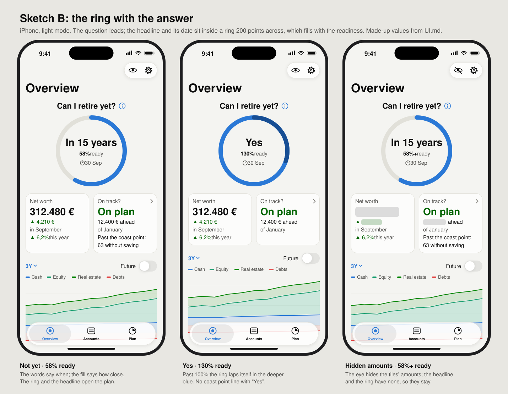
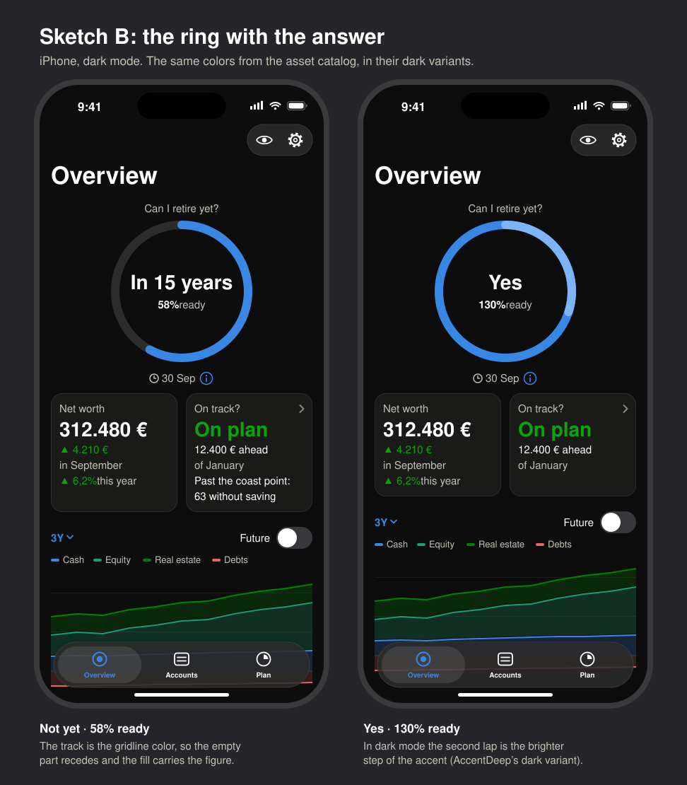
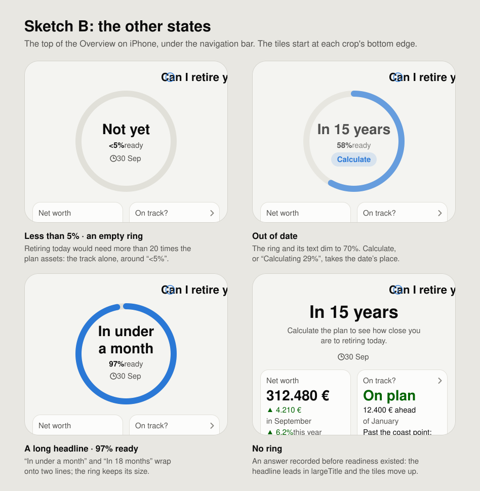
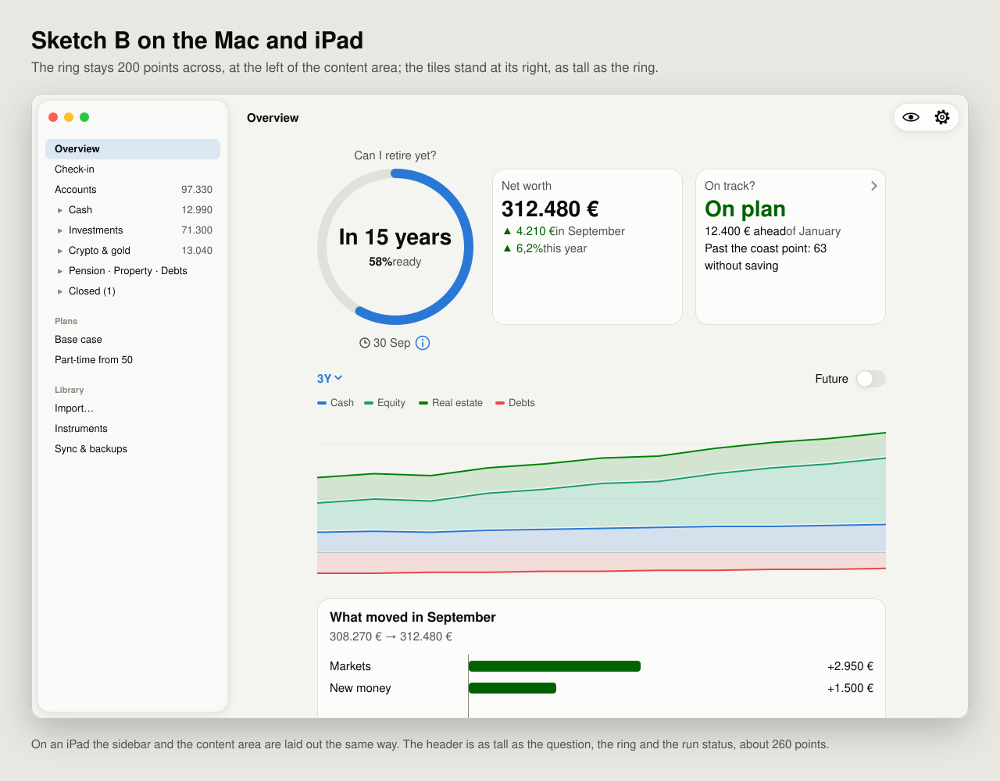
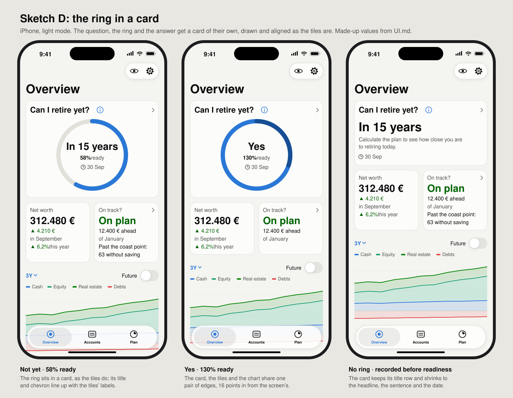
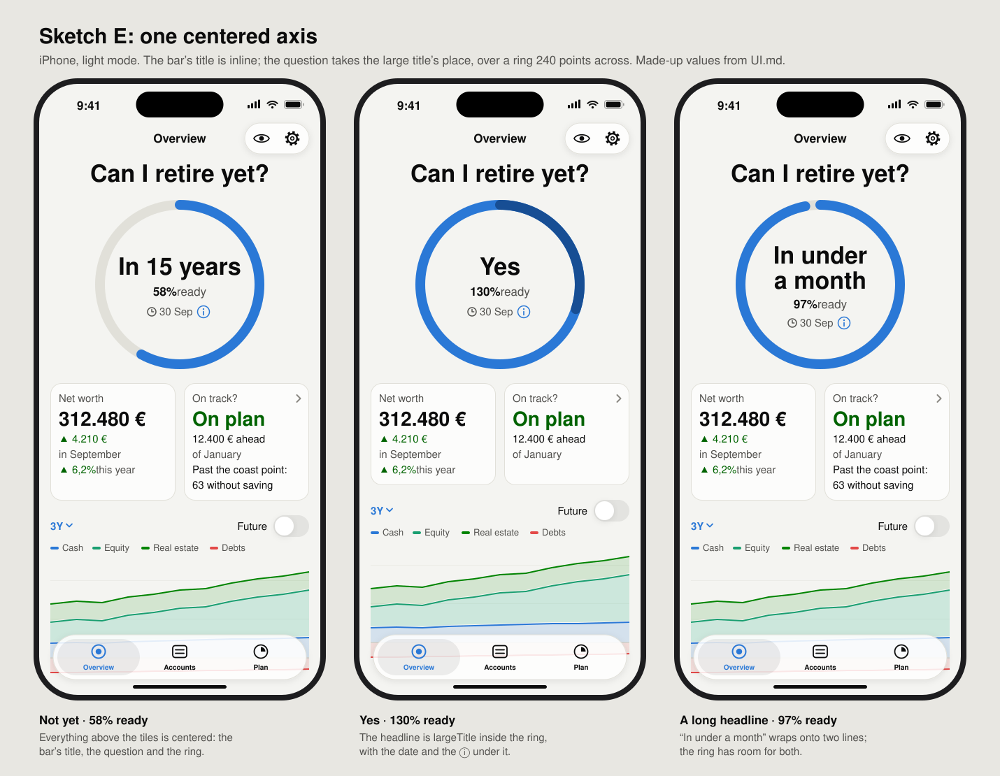
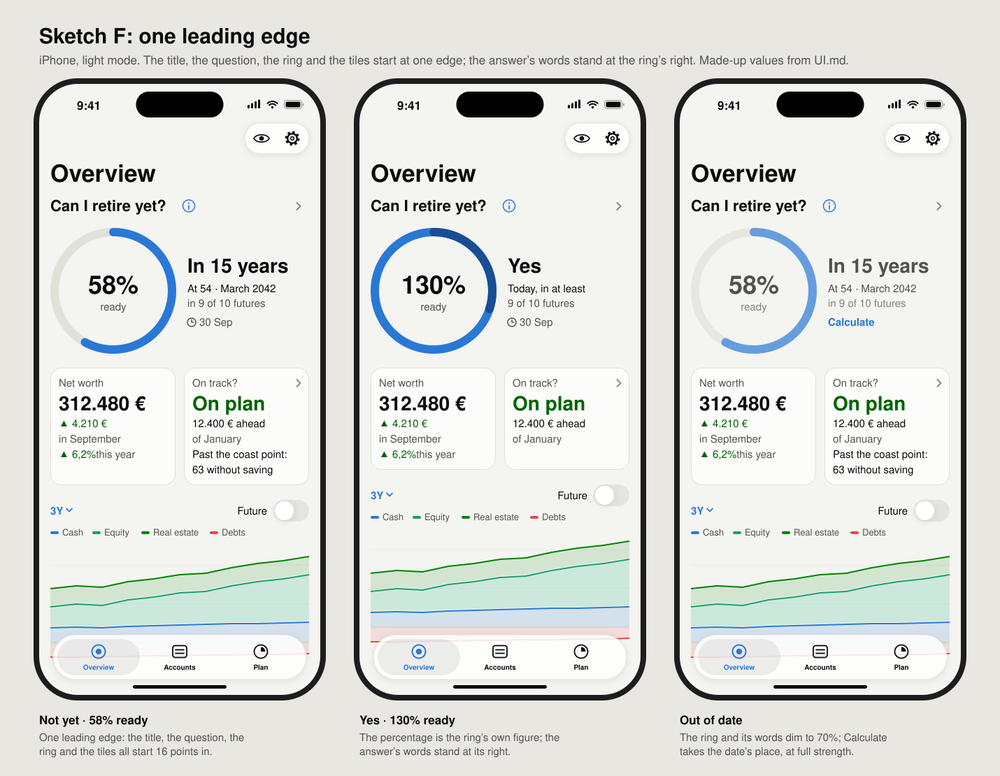

# Readiness ring: directions for the Overview's header

The readiness ring is the Overview's most important figure, but it doesn't read that way. On iPhone it's 48 points across, at the headline's right. The label row's run status, ⓘ and chevron sit right above it, and its "58% ready" label sits to its left, so that corner is crowded, and the headline and the tiles draw the eye first.

This note sketches three directions that make the ring the header's focus. The owner chose Sketch B; its [mockups](#mockups) show it in the app's colors. [Three more directions](#aligning-the-header-sketches-d-e-and-f) keep B's large ring and fix how it lines up with the screen's title. Nothing here is built. The chosen direction gets a follow-up issue that builds it in `OverviewHeader` and updates [UI.md](../UI.md#overview), "Can I retire yet?".

All values are UI.md's made-up ones.

## How to read the sketches

Each sketch is the top of the Overview on an iPhone, drawn as UI.md draws it. A ring is drawn as a rounded box that fills clockwise from the top center:

- `─ │ ╭ ╮ ╰ ╯` is the gridline track.
- `━ ┃ ┏ ┓ ┗ ┛` is the fill, in the accent.
- `═ ║ ╔ ╗ ╚ ╝` is the lap past 100%, drawn over the full ring in the deeper blue (`Palette.accentDeep`).

Each sketch shows three states, as the header's previews name them:

- **Not yet:** "In 15 years", readiness 58%, an answer recorded at the 30 Sep check-in ("◷ 30 Sep").
- **Yes, lapping:** "Yes", readiness 130%: a full ring and 30% more.
- **Hidden amounts:** the eye is on. The readiness is a lower bound here ("58%+"), as in the header's preview.

## What every direction keeps

These are UI.md's rules for the ring, and each sketch keeps them:

- **The label** follows `ReadinessFigure`: rounded down below 100%, "58%+" for a lower bound, "<5%" with an empty ring when retiring today would need more than 20 times the plan assets, and the real number past 100% ("130%").
- **Lapping:** past 100% the ring laps itself, the part past 100% in the deeper blue; it stops drawing at 200% (`ReadinessRing(laps: true)`, `lappingFill`).
- **VoiceOver** reads the headline and the ring as one element, in the same words as today: "Not yet. In about 15 years, at 54, in March 2042, in 9 of 10 futures. 58% of what you'd need to retire today." The order is the headline first, even where the ring is drawn first.
- **Hidden amounts:** the headline and the ring have no amounts, so the eye leaves them as they are; only the tiles change (the *Net worth* amount and its change become placeholders, *On track?* reads "▬▬▬ ahead"). In a feedback screenshot the headline, the ring and its number are hidden too (`.privacySensitiveInFeedback()`).
- **Out of date:** the headline, the ring and its label dim, as the Plan screen dims out-of-date results.
- **Size:** the ring keeps its size at every text size; the text inside or beside it is capped so it fits.
- **The tiles** stay as they are, under the answer.

## Today

```
┌──────────────────────────────────────────┐
│ Overview                        👁   ⚙︎   │
│                                          │
│ Can I retire yet?           ◷ 30 Sep ⓘ › │
│ In 15 years                   58%  ╭─╮   │
│                             ready  ╰─╯   │
│ ╭──────────────────╮╭──────────────────╮ │
│ │ Net worth        ││ On track?      › │ │
│ │ 312.480 €        ││ On plan          │ │
│ │ ▲ 4.210 €        ││ 12.400 € ahead   │ │
│ │ in September     ││ of January       │ │
│ │ ▲ 6,2% this year ││ Past the coast   │ │
│ │                  ││ point: 63 …      │ │
│ ╰──────────────────╯╰──────────────────╯ │
└──────────────────────────────────────────┘
```

The headline is largeTitle, the tiles' figures are title, and the ring is 48 points with its label in subheadline. Five things share the top right: the run status, the ⓘ, the chevron, the label and the ring.

## Sketch A: ring as hero

A large ring, about 160 points across, centered, with the percentage inside it. The headline goes under the ring.

### Not yet

```
┌──────────────────────────────────────────┐
│ Overview                        👁   ⚙︎   │
│                                          │
│ Can I retire yet?                      › │
│                                          │
│           ╭────────━━━━━━━━━┓            │
│           │                 ┃            │
│           │                 ┃            │
│           │                 ┃            │
│           │       58%       ┃            │
│           │      ready      ┃            │
│           │                 ┃            │
│           │                 ┃            │
│           ╰─────━━━━━━━━━━━━┛            │
│                                          │
│               In 15 years                │
│               ◷ 30 Sep  ⓘ                │
│ ╭──────────────────╮╭──────────────────╮ │
│ │ Net worth        ││ On track?      › │ │
│ │ 312.480 €        ││ On plan          │ │
│ │ ▲ 4.210 €        ││ 12.400 € ahead   │ │
│ │ in September     ││ of January       │ │
│ │ ▲ 6,2% this year ││ Past the coast   │ │
│ │                  ││ point: 63 …      │ │
│ ╰──────────────────╯╰──────────────────╯ │
└──────────────────────────────────────────┘
```

### Yes, lapping

```
┌──────────────────────────────────────────┐
│ Can I retire yet?                      › │
│                                          │
│           ┏━━━━━━━━═════════╗            │
│           ┃                 ║            │
│           ┃                 ║            │
│           ┃                 ║            │
│           ┃      130%       ║            │
│           ┃      ready      ║            │
│           ┃                 ║            │
│           ┃                 ┃            │
│           ┗━━━━━━━━━━━━━━━━━┛            │
│                                          │
│                   Yes                    │
│               ◷ 30 Sep  ⓘ                │
└──────────────────────────────────────────┘
```

The tiles are as in *Not yet*, without the coast point line (UI.md: not with "Yes").

### Hidden amounts

```
┌──────────────────────────────────────────┐
│ Overview                        👁   ⚙︎   │
│                                          │
│ Can I retire yet?                      › │
│                                          │
│           ╭────────━━━━━━━━━┓            │
│           │                 ┃            │
│           │                 ┃            │
│           │                 ┃            │
│           │      58%+       ┃            │
│           │      ready      ┃            │
│           │                 ┃            │
│           │                 ┃            │
│           ╰─────━━━━━━━━━━━━┛            │
│                                          │
│               In 15 years                │
│               ◷ 30 Sep  ⓘ                │
│ ╭──────────────────╮╭──────────────────╮ │
│ │ Net worth        ││ On track?      › │ │
│ │ ▬▬▬▬▬▬           ││ On plan          │ │
│ │ ▲ ▬▬▬▬           ││ ▬▬▬ ahead        │ │
│ │ in September     ││ of January       │ │
│ │ ▲ 6,2% this year ││ Past the coast   │ │
│ │                  ││ point: 63 …      │ │
│ ╰──────────────────╯╰──────────────────╯ │
└──────────────────────────────────────────┘
```

### Notes

- **What it changes:** the readiness becomes the first thing you read. The percentage moves inside the ring in largeTitle, with "ready" under it in subheadline. The headline moves under the ring and shrinks to title. The ring's line is about 14 points wide.
- **What it gives up:** the answer in words ("In 15 years") is no longer the largest text, so the header answers "how close am I?" before "when?". The header grows by about 180 points, so the tiles and the chart move down; on a small iPhone the tiles' last rows go below the fold.
- **The label row's items:** "Can I retire yet?" and the chevron stay on the label row, now with nothing between them. The run status ("◷ 30 Sep", *Calculate*, "Calculating 29%") and the ⓘ move to a line under the headline, centered. The line is there only when it has something to show; the ⓘ always is.
- **Large text:** the percentage inside the ring is capped at the size that fits "130%" (and "58%+"); the headline under it wraps as it does today.
- **iPad and Mac:** the ring stays at the left of the content area, about 160 points across, with the headline, the run status line and the two tiles in a column at its right. The header is then no taller than the ring.

## Sketch B: ring with the answer

The headline and the run status go inside a large ring, about 200 points across, with readiness as its fill. The ring is the answer, and "Can I retire yet?" above it is the header's title.

### Not yet

```
┌──────────────────────────────────────────┐
│ Overview                        👁   ⚙︎   │
│                                          │
│            Can I retire yet? ⓘ           │
│        ╭───────────━━━━━━━━━━━━┓         │
│        │                       ┃         │
│        │                       ┃         │
│        │      In 15 years      ┃         │
│        │                       ┃         │
│        │       58% ready       ┃         │
│        │                       ┃         │
│        │       ◷ 30 Sep        ┃         │
│        │                       ┃         │
│        │                       ┃         │
│        ╰───────━━━━━━━━━━━━━━━━┛         │
│                                          │
│ ╭──────────────────╮╭──────────────────╮ │
│ │ Net worth        ││ On track?      › │ │
│ │ 312.480 €        ││ On plan          │ │
│ │ ▲ 4.210 €        ││ 12.400 € ahead   │ │
│ │ in September     ││ of January       │ │
│ │ ▲ 6,2% this year ││ Past the coast   │ │
│ │                  ││ point: 63 …      │ │
│ ╰──────────────────╯╰──────────────────╯ │
└──────────────────────────────────────────┘
```

### Yes, lapping

```
┌──────────────────────────────────────────┐
│            Can I retire yet? ⓘ           │
│        ┏━━━━━━━━━━━════════════╗         │
│        ┃                       ║         │
│        ┃                       ║         │
│        ┃          Yes          ║         │
│        ┃                       ║         │
│        ┃      130% ready       ║         │
│        ┃                       ║         │
│        ┃       ◷ 30 Sep        ║         │
│        ┃                       ┃         │
│        ┃                       ┃         │
│        ┗━━━━━━━━━━━━━━━━━━━━━━━┛         │
└──────────────────────────────────────────┘
```

The tiles are as in *Not yet*, without the coast point line.

### Hidden amounts

```
┌──────────────────────────────────────────┐
│ Overview                        👁   ⚙︎   │
│                                          │
│            Can I retire yet? ⓘ           │
│        ╭───────────━━━━━━━━━━━━┓         │
│        │                       ┃         │
│        │                       ┃         │
│        │      In 15 years      ┃         │
│        │                       ┃         │
│        │      58%+ ready       ┃         │
│        │                       ┃         │
│        │       ◷ 30 Sep        ┃         │
│        │                       ┃         │
│        │                       ┃         │
│        ╰───────━━━━━━━━━━━━━━━━┛         │
│                                          │
│ ╭──────────────────╮╭──────────────────╮ │
│ │ Net worth        ││ On track?      › │ │
│ │ ▬▬▬▬▬▬           ││ On plan          │ │
│ │ ▲ ▬▬▬▬           ││ ▬▬▬ ahead        │ │
│ │ in September     ││ of January       │ │
│ │ ▲ 6,2% this year ││ Past the coast   │ │
│ │                  ││ point: 63 …      │ │
│ ╰──────────────────╯╰──────────────────╯ │
└──────────────────────────────────────────┘
```

### Notes

- **What it changes:** the answer and the readiness become one figure: the words say when, the fill says how close. The headline is title, inside the ring; "58% ready" is subheadline under it, and the run status ("◷ 30 Sep") is under that, in subheadline and the secondary color. "Can I retire yet?" is the header's title, centered above the ring in title2, bold, in the ink color. The ring's line is about 12 points wide.
- **What it gives up:** the headline has to fit inside the ring. "In 15 years", "Yes" and "Not yet" do; "In under a month" and "In 18 months" wrap onto two lines, and at the largest text sizes the headline is capped smaller than today's. The header grows by about 170 points. The ring reads as a progress bar toward the date in the headline, which it isn't: 58% ready doesn't mean 58% of the 15 years have passed.
- **The label row's items:** there's no label row. The ⓘ follows the question ("Can I retire yet? ⓘ"), since it explains the whole answer. The run status goes inside the ring, under "58% ready": "◷ 30 Sep", *Calculate*, or "Calculating 29%". *Calculate* is a button of its own inside the ring's button, as the ⓘ and *Calculate* are inside the header today. The chevron goes: the ring and the headline are one element for VoiceOver already, and it becomes the button that opens the plan (the button trait and the default action), where the chevron is that button today. On the Mac and iPad that element also takes keyboard focus.
- **Large text:** the headline, "58% ready" and the run status inside the ring are capped so the longest headline fits on two lines with both under it; the ring keeps its size. The question above the ring wraps.
- **iPad and Mac:** the ring stays about 200 points across, at the left, with "Can I retire yet? ⓘ" above it; the two tiles stand side by side at its right, as tall as the ring.

### Mockups

Sketch B drawn in the app's colors (the asset catalog's light and dark variants), text styles and spacing, on a 6.3-inch iPhone (402 × 874 points) and in a Mac window of 1200 × 800. The status bar, toolbar and tab bar are there only for context.





The header's other states: "<5%" with an empty ring; out of date, where the ring and its text dim and *Calculate* takes the run status's place inside the ring; a headline that wraps inside the ring, with the run status under it; and an answer recorded before readiness existed, which has no ring, so the headline leads in largeTitle with "Calculate the plan to see how close you are to retiring today." and the run status under it, and the tiles move up.





## Sketch C: quiet header

The layout stays as today, the headline at the left and the ring at the right, but the ring doubles to about 96 points, takes its percentage inside, and has the right side to itself. Everything else leaves its corner.

### Not yet

```
┌──────────────────────────────────────────┐
│ Overview                        👁   ⚙︎   │
│                                          │
│ Can I retire yet? ⓘ        ╭─────━━━━━━┓ │
│                            │           ┃ │
│ In 15 years                │    58%    ┃ │
│                            │   ready   ┃ │
│ ◷ 30 Sep                   │           ┃ │
│                            ╰───━━━━━━━━┛ │
│ ╭──────────────────╮╭──────────────────╮ │
│ │ Net worth        ││ On track?      › │ │
│ │ 312.480 €        ││ On plan          │ │
│ │ ▲ 4.210 €        ││ 12.400 € ahead   │ │
│ │ in September     ││ of January       │ │
│ │ ▲ 6,2% this year ││ Past the coast   │ │
│ │                  ││ point: 63 …      │ │
│ ╰──────────────────╯╰──────────────────╯ │
└──────────────────────────────────────────┘
```

### Yes, lapping

```
┌──────────────────────────────────────────┐
│ Can I retire yet? ⓘ        ┏━━━━━══════╗ │
│                            ┃           ║ │
│ Yes                        ┃   130%    ║ │
│                            ┃   ready   ║ │
│ ◷ 30 Sep                   ┃           ┃ │
│                            ┗━━━━━━━━━━━┛ │
└──────────────────────────────────────────┘
```

The tiles are as in *Not yet*, without the coast point line.

### Hidden amounts

```
┌──────────────────────────────────────────┐
│ Overview                        👁   ⚙︎   │
│                                          │
│ Can I retire yet? ⓘ        ╭─────━━━━━━┓ │
│                            │           ┃ │
│ In 15 years                │   58%+    ┃ │
│                            │   ready   ┃ │
│ ◷ 30 Sep                   │           ┃ │
│                            ╰───━━━━━━━━┛ │
│ ╭──────────────────╮╭──────────────────╮ │
│ │ Net worth        ││ On track?      › │ │
│ │ ▬▬▬▬▬▬           ││ On plan          │ │
│ │ ▲ ▬▬▬▬           ││ ▬▬▬ ahead        │ │
│ │ in September     ││ of January       │ │
│ │ ▲ 6,2% this year ││ Past the coast   │ │
│ │                  ││ point: 63 …      │ │
│ ╰──────────────────╯╰──────────────────╯ │
└──────────────────────────────────────────┘
```

### Notes

- **What it changes:** the ring grows from 48 to about 96 points and spans the question, the headline and the run status, so it's as tall as the text beside it. "58%" moves inside it in title, with "ready" under it in subheadline. The ring's line is about 8 points wide. The headline stays largeTitle at the left.
- **What it gives up:** the least of the three. The headline is still the first thing you read, so the ring is the header's second figure rather than its first. Inside a 96-point ring, "130%" and "58%+" in title are a tight fit and may need to shrink a little. The header grows by about one line.
- **The label row's items:** there's no label row on the right any more. The ⓘ follows the question ("Can I retire yet? ⓘ"), since it explains the whole answer. The run status moves to a line of its own under the headline, at the left: "◷ 30 Sep", *Calculate*, or "Calculating 29%"; that's where "Base case can't be calculated: …" already goes. The line is there only when it has something to show. The chevron goes, as in Sketch B: the headline and the ring become the button that opens the plan.
- **Large text:** when the headline and the ring don't fit on one line, the ring goes on a line of its own under the headline, at the left, as it does today. The text inside the ring is capped so "130%" fits.
- **iPad and Mac:** the same layout with more room: the ring grows to about 112 points, and the tiles stay under the answer at the full width.

## Comparison

| | A: ring as hero | B: ring with the answer | C: quiet header |
| --- | --- | --- | --- |
| Read first | the readiness | the answer and the readiness at once | the answer, then the readiness |
| Ring on iPhone | about 160 points, centered | about 200 points, centered | about 96 points, at the right |
| Headline | title, under the ring | title, inside the ring | largeTitle, at the left |
| The percentage | largeTitle, inside the ring | subheadline, inside under the headline | title, inside the ring |
| Run status and ⓘ | a line under the headline | ⓘ after the question; run status inside the ring | ⓘ after the question; run status under the headline |
| Chevron | stays, alone on the label row | goes: the answer is the button | goes: the answer is the button |
| Header height on iPhone | about 180 points more | about 170 points more | about one line more |

## Aligning the header: Sketches D, E and F

In Sketch B, the header's parts each line up with something different. "Overview", the navigation bar's large title, is at the leading edge. "Can I retire yet?" is centered, but its ⓘ hangs off its end, so the pair sits right of the screen's center. The ring is centered on the screen, and the tiles under it span the width. That makes two titles of different sizes, one at the left and one in the middle, over a ring that lines up with neither.

Each sketch below keeps B's large ring and picks one rule for everything above the tiles:

- **D: the ring in a card:** the ring gets a card of its own, drawn and aligned as the tiles are.
- **E: one centered axis:** the bar's title becomes inline, and the question takes the large title's place; everything is centered.
- **F: one leading edge:** everything starts 16 points in, and the answer's words stand at the ring's right.

They're drawn as B's mockups are: in the app's light colors, on a 6.3-inch iPhone, with the status bar, toolbar and tab bar for context. The values are UI.md's made-up ones.

### Sketch D: the ring in a card



- **What it changes:** the question, the ring and the answer go in a card as wide as the two tiles, drawn as they are (the card's background and border, 16-point corners). The card's title row is laid out like a tile's label row: "Can I retire yet?" at the card's leading edge in title2, bold, its ⓘ after it, and the chevron at its trailing edge, above *On track?*'s chevron. The ring is 200 points across, centered in the card, with the headline, "58% ready" and "◷ 30 Sep" inside, as in B. "Overview" stays the large title.
- **What it gives up:** the card adds its padding to B's height, so the tiles start about 20 points lower. The ring is centered under a title at the card's leading edge, as in a widget.
- **The chevron:** the whole card is the button that opens the plan, as *On track?* is the button that opens Progress; the chevron says so. The ⓘ and *Calculate* stay buttons of their own inside it.
- **No ring:** the card keeps its title row. The headline leads in largeTitle, with "Calculate the plan to see how close you are to retiring today." and the run status under it, and the card shrinks.
- **iPad and Mac:** the card takes the ring's place in B's [Mac mockup](readiness-ring-b-mac.svg), at the left, as tall as the tiles beside it.

### Sketch E: one centered axis



- **What it changes:** the navigation bar's title is inline ("Overview", small and centered in the bar, as iOS draws an inline title), and "Can I retire yet?" takes the large title's place, in largeTitle, centered. The ring grows to 240 points with a 14-point line. Inside it, the headline is largeTitle, "58% ready" is body, and the run status with the ⓘ after it ("◷ 30 Sep ⓘ") is under that. Everything above the tiles is on the screen's center line.
- **What it gives up:** the Overview is the only tab without a large title, so its top doesn't match Accounts and Plan. The ⓘ moves inside the ring, a button inside the ring's button, as *Calculate* is in B. The header is as tall as B's.
- **The chevron:** none, as in B: the ring is the button that opens the plan.
- **Large text:** the question wraps onto two centered lines; the text inside the ring is capped as in B. "In under a month" wraps onto two lines inside the ring at the default size.
- **iPad and Mac:** the window's title is "Overview" already. The question and the ring are centered over the two tiles, which stand side by side under them, so the header is taller than in B's Mac layout.

### Sketch F: one leading edge



- **What it changes:** "Overview", "Can I retire yet?", the ring and the tiles all start at the 16-point leading edge. The question is title2, bold, with its ⓘ after it and the chevron at the row's trailing edge, above *On track?*'s chevron. The ring is 180 points across, with "58%" inside in a 36-point bold figure and "ready" under it. The answer's words stand at its right: the headline in title, then "At 54 · March 2042" and "in 9 of 10 futures" (what the ⓘ says today, and what the *Time to retire* widget shows), then the run status. With "Yes" the lines read "Today, in at least" and "9 of 10 futures", from VoiceOver's "You could retire today, in at least 9 of 10 futures."
- **What it gives up:** the headline leaves the ring, so the ring and the words stand side by side again, as today and in Sketch C, only larger; B's "the ring is the answer" is gone. The column at the ring's right is about 174 points wide, so "In under a month" wraps there. It's the shortest of the three: the tiles start about 20 points higher than in B.
- **The chevron:** the question row, the ring and the words are one element and the button that opens the plan; the chevron on the question's row marks it, as on *On track?*.
- **Out of date:** the ring and the words dim, and *Calculate* takes the run status's place in the column, at full strength. It's no longer a button drawn inside the ring.
- **Large text:** when the column doesn't fit at the ring's right, it goes under the ring, at the leading edge.
- **iPad and Mac:** the ring and its column stand at the left of the content area, the two tiles at their right.

### Comparing D, E and F

| | D: the ring in a card | E: one centered axis | F: one leading edge |
| --- | --- | --- | --- |
| Lines up with | the tiles' edges and labels | the screen's center | the screen's leading edge |
| "Overview" | the large title | inline in the bar | the large title |
| The question | the card's title, title2 | the large title, largeTitle | title2, at the leading edge |
| Ring on iPhone | 200 points, centered in the card | 240 points, centered | 180 points, at the leading edge |
| Inside the ring | the headline, the readiness, the run status | the headline, the readiness, the run status and ⓘ | the percentage |
| The ⓘ | after the question | inside the ring, after the run status | after the question |
| Chevron | the card's, at its trailing edge | none: the ring is the button | at the question's row's trailing edge |
| Tiles on iPhone, against B | about 20 points lower | where they are in B | about 20 points higher |

## Open questions

- **The chevron's job (B and C):** today the chevron is the button VoiceOver and the keyboard use to open the plan, because the ⓘ and *Calculate* inside the header need taps of their own. Making the headline-and-ring element the button keeps one stop for VoiceOver; the follow-up should check that the Mac's keyboard focus reaches it.
- **The *Readiness* widget:** its ring is full at 100% and has its number beside it. Should it follow the chosen direction (the number inside the ring, in A and C), or stay as it is?
